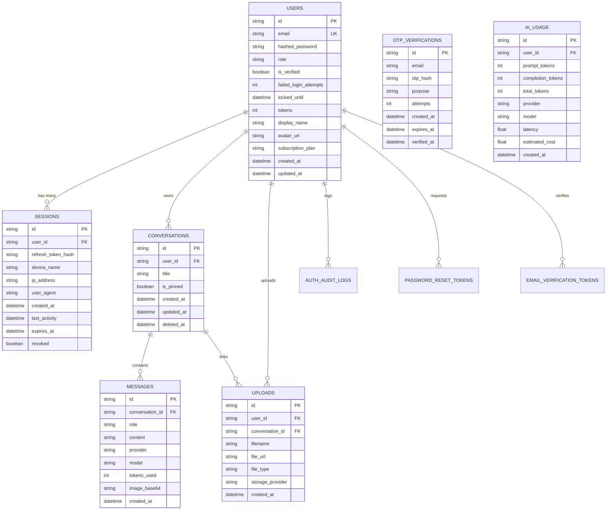
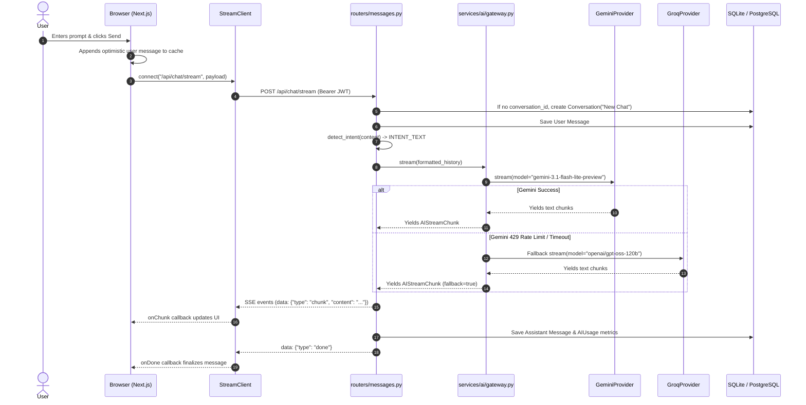
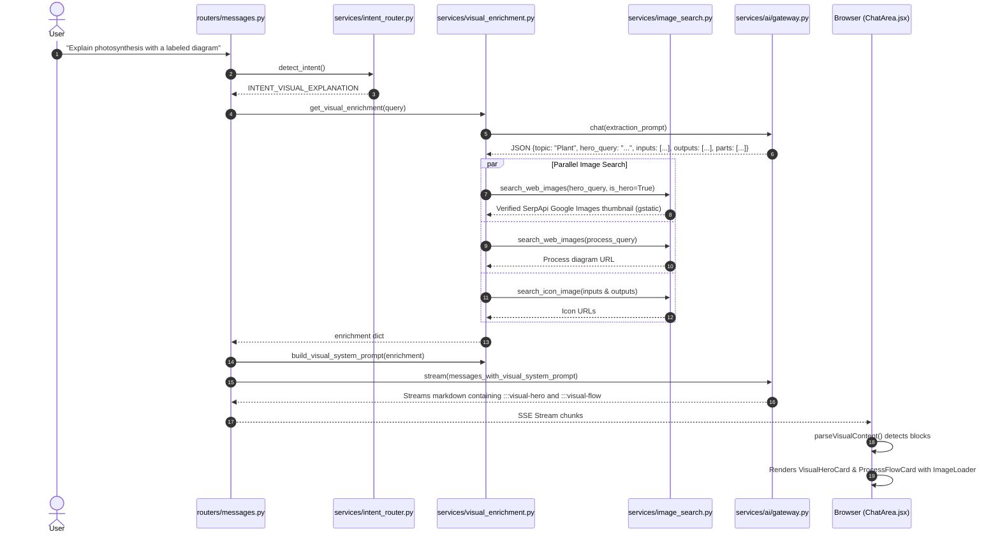
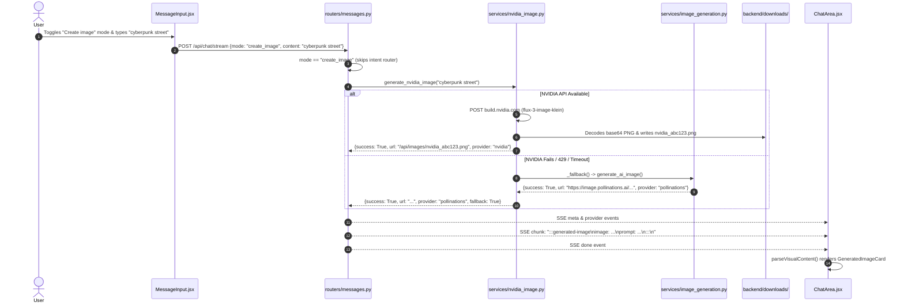
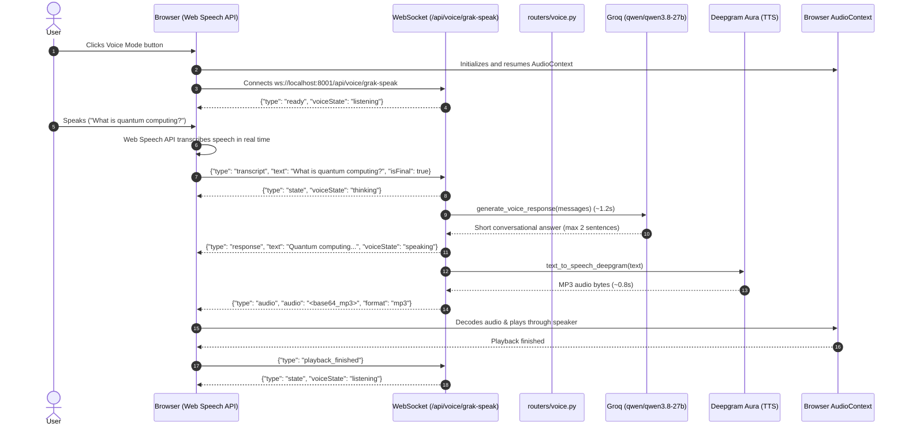

# OmniAI (Grak AI) — Project Facts Sheet

**Course / Purpose:** Software Design and Architecture (SDA) University Project Documentation  
**Generated Date:** 2026-10-19  
**Analysis Scope:** Entire OmniAI repository (Frontend, Backend, Database, AI Providers, Real Features & Status)  
**Security Notice:** Zero secrets or active API tokens are present in this document. Only environment variable names are referenced.

---

## 1. System Overview

### 1.1 Architecture Summary

OmniAI (branded user-facing as **Grak AI**) is an intelligent conversational AI collaboration platform featuring:

- Real-time Server-Sent Events (SSE) AI streaming with connection-level multi-provider automatic failover.
- Multimodal capability supporting document text extraction (PDF, DOCX, TXT) and Gemini Vision OCR.
- Dynamic intent routing (Code, Image Generation, Visual Explanation with Labeled Diagrams, and Structured Text).
- Integrated dual-mode Image Synthesis: NVIDIA FLUX (`black-forest-labs/flux-3-image-klein`) and Pollinations FLUX.1.
- Real-time interactive voice conversation pipeline (Grak Speak) leveraging browser Web Speech recognition, high-speed Groq LLM inference, and Deepgram Aura neural text-to-speech (TTS).
- Dual-tier authentication featuring HttpOnly cookie session rotation, email OTP (Brevo), and Firebase (Google OAuth & Phone OTP).

```
                      ┌──────────────────────────────────────────────┐
                      │          Next.js 16 Frontend (Client)        │
                      │  App Router (React 19) + Turbopack + Tailwind │
                      └──────┬──────────────────┬────────────────────┘
                             │ HTTP/SSE         │ WebSocket
                             ▼                  ▼
┌──────────────────────────────────────┐     ┌───────────────────────────────────────┐
│     FastAPI Backend (REST & SSE)     │     │      Voice Gateway WebSocket          │
│   Port 8001 / Uvicorn / Python 3.12  │     │       /api/voice/grak-speak           │
└──────┬────────────┬───────────┬──────┘     └──────┬─────────────────┬──────────────┘
       │            │           │                   │                 │
       ▼            ▼           ▼                   ▼                 ▼
 ┌──────────┐ ┌───────────┐ ┌──────────────┐ ┌─────────────┐   ┌─────────────────────┐
 │SQLAlchemy│ │AIGateway  │ │External APIs │ │  Fast LLM   │   │    Deepgram TTS     │
 │(SQLite/  │ │Gemini 3.1 │ │SerpApi/Tavily│ │ Groq Qwen/  │   │  Aura Asteria (MP3) │
 │Postgres) │ │-> Groq    │ │Pollinations  │ │ OpenRouter  │   └─────────────────────┘
 └──────────┘ └───────────┘ │NVIDIA FLUX   │ └─────────────┘
                            │Brevo Email   │
                            └──────────────┘
```

### 1.2 Technology Stack

| Layer                    | Technologies & Libraries                                                       | Details / Version                                                                                   |
| ------------------------ | ------------------------------------------------------------------------------ | --------------------------------------------------------------------------------------------------- |
| **Frontend Framework**   | Next.js (App Router), React, React-DOM                                         | Next.js 16.2.10, React 19 (Canary/Latest), Turbopack                                                |
| **Styling & Animation**  | TailwindCSS, PostCSS, Framer Motion, Lucide React                              | Tailwind 3.4.19, Framer Motion 12.42, Lucide 0.300                                                  |
| **Markdown & Math**      | react-markdown, remark-gfm, remark-math, rehype-katex, Prism SyntaxHighlighter | KaTeX math formatting (`$$` and `$`), Prism syntax highlighting                                     |
| **Client State & Cache** | TanStack React Query v5, React Context (`AuthContext`)                         | `@tanstack/react-query` v5.18.1, Cache queries: `["conversations"]`, `["conversation", id]`         |
| **Client Storage**       | Browser `localStorage`, `sessionStorage`, HttpOnly Cookies                     | Tokens in `localStorage`, refresh token in HttpOnly cookie; projects & connectors in `localStorage` |
| **Backend Framework**    | FastAPI, Starlette, Uvicorn                                                    | Python 3.12, ASGI architecture                                                                      |
| **Database & ORM**       | SQLAlchemy 2.0+, Alembic                                                       | SQLite (`test.db`) in local dev; PostgreSQL (`postgresql+psycopg://`) configured for prod           |
| **Security & Auth**      | PyJWT, Bcrypt/Passlib, SlowAPI (Rate Limiter), Firebase Admin SDK              | JWT HS256, Bcrypt password hashing, SlowAPI with IP rate limiting                                   |
| **Document Processing**  | PyPDF2, python-docx, python-pptx, Pillow (PIL)                                 | PDF parsing, DOCX parsing, PPTX generation, image thumbnailing                                      |
| **AI SDKs & HTTP**       | `google-genai`, `groq` SDK, `openai` SDK, `httpx`, `requests`                  | Async streaming, connection pooling, exponential backoff                                            |
| **Audio & Speech**       | Web Speech API (Client STT), WebSockets (`websockets 15`), Deepgram REST API   | Full duplex WebSocket, Web Speech API recognition, Deepgram Aura Asteria TTS                        |

### 1.3 Folder Structure (Top 2 Levels)

```
OmniAI/
├── backend/                        # FastAPI Application root
│   ├── core/                       # Core database models & base utilities
│   │   ├── models/                 # Modular domain database entities (User, Message, etc.)
│   │   └── __init__.py             # Core package initialization
│   ├── downloads/                  # Static directory for generated images and exported documents
│   ├── routers/                    # FastAPI route controllers (Auth, Chat, Conv, Uploads, Voice)
│   ├── services/                   # Business logic, third-party adapters & AI provider gateway
│   │   ├── ai/                     # Gateway orchestration and vendor provider classes
│   │   └── ...                     # Specialized service modules (intent, vision, search, OCR)
│   ├── tests/                      # Pytest unit and integration test suites
│   ├── config.py                   # Pydantic BaseSettings loading .env configuration
│   ├── database.py                 # SQLAlchemy Engine, SessionLocal, and get_db dependency
│   ├── main.py                     # App entry point, CORS, static mounts, and diagnostics
│   ├── middleware.py               # Security headers & SlowAPI rate limiting configuration
│   ├── models.py                   # Backwards-compatible model re-exporter
│   ├── requirements.txt            # Python runtime dependencies
│   └── schemas.py                  # Pydantic request and response transfer schemas
├── frontend/                       # Next.js App Router client application
│   ├── app/                        # Next.js App Router pages and API routes
│   │   ├── (auth)/                 # Authentication route group (login, register, reset)
│   │   ├── (dashboard)/            # Authenticated application view (chat, design system)
│   │   ├── api/                    # Next.js edge API route handlers
│   │   ├── ping/                   # Server liveness silent route handler
│   │   └── layout.jsx              # Global HTML shell & context provider injection
│   ├── components/                 # Reusable UI component modules
│   │   ├── chat/                   # Domain chat components (ChatArea, MessageInput, Sidebar, etc.)
│   │   ├── landing/                # Public marketing navigation components
│   │   └── ui/                     # Design system primitives (Button, Modal, Input, Badge, etc.)
│   ├── config/                     # Client application branding and string constants
│   ├── context/                    # React Context providers (AuthContext)
│   ├── lib/                        # Client libraries (API client, stream reader, Firebase SDK)
│   ├── public/                     # Static media, logos, and branding artwork
│   ├── package.json                # Frontend package dependencies and scripts
│   └── tailwind.config.js          # TailwindCSS theme, colors, and layout definition
└── docs/                           # Project facts and SDA documentation
    └── PROJECT_FACTS.md            # System architecture and UML facts sheet (This file)
```

---

## 2. Backend Architecture

### 2.1 Routers Overview

| Router File                        | Prefix / Path        | Responsibility                                                                               |
| ---------------------------------- | -------------------- | -------------------------------------------------------------------------------------------- |
| `backend/routers/auth.py`          | `/api/auth`          | User authentication, token issuance & rotation, Firebase integration, Brevo email OTP.       |
| `backend/routers/conversations.py` | `/api/conversations` | Conversation CRUD, listing with pagination, search, pinning, and soft delete.                |
| `backend/routers/messages.py`      | `/api/chat`          | Main SSE chat stream, lazy conversation creation, intent routing, AI response generation.    |
| `backend/routers/uploads.py`       | `/api/uploads`       | File ingestion (PDF, DOCX, TXT, Images), background text parsing, Gemini Vision OCR.         |
| `backend/routers/voice.py`         | `/api/voice`         | Full-duplex WebSocket (`/api/voice/grak-speak`) for low-latency voice chat and Deepgram TTS. |

---

### 2.2 Detailed Router & Service Specifications

#### `backend/main.py`

- **Purpose:** Primary application initialization, middleware configuration, static downloads mount, router registration, and diagnostics endpoints.
- **Top-Level Endpoints:**
  - `GET /` — Health status check. Returns `{"success": True, "data": {"status": "OmniAI Backend is running"}}`. No auth required.
  - `GET /api/diagnostics` — Returns runtime diagnostic health status of AI providers (`PROVIDER_DIAGNOSTICS`). No auth required.
  - `POST /api/diagnostics/refresh` — Triggers `check_provider_health()` across providers and returns updated state. No auth required.
  - `POST /api/research` — Executes `hybrid_web_research(req.query)`. Auth required (`get_current_user`). Returns JSON.
  - `POST /api/research_web` — Alternate web research endpoint calling `hybrid_web_research(req.query)`. Auth required. Returns JSON.
  - `POST /api/image` — Legacy HuggingFace Stable Diffusion image generation. Saves to `downloads/`. Auth required. Returns JSON.
  - `POST /api/document` — Generates outline via AI and compiles Word (`.docx`) or PowerPoint (`.pptx`) file. Auth required. Returns JSON.
- **Dependencies:** `routers.*`, `services.auth`, `services.ai_engine`, `services.document_generator`, `services.firebase_service`.

#### `backend/routers/auth.py`

- **Purpose:** Authentication gateway supporting Firebase OAuth, email OTP, and JWT rotation.
- **Top-Level Functions:**
  - `hash_token(token: str) -> str`: Hashes tokens using SHA-256 for secure DB lookup.
- **Endpoints:**
  - `POST /api/auth/firebase` — Validates Firebase Bearer token from header via Firebase Admin SDK. Auto-provisions user if new. Generates access JWT (15m) and refresh token (7d) in HttpOnly cookie. Rate limit: 5/min. No auth required.
  - `POST /api/auth/refresh` — Validates refresh token from HttpOnly cookie. Rotates refresh token hash in DB and issues new access token. Rate limit: 10/min. No auth required.
  - `POST /api/auth/logout` — Revokes current session in DB and clears `refresh_token` cookie. No auth required.
  - `POST /api/auth/logout-all` — Revokes all active user sessions in DB and clears cookie. Auth required.
  - `GET /api/auth/me` — Fetches authenticated user profile, token balance, and verification status. Auth required.
  - `POST /api/auth/send-otp` — Generates 6-digit cryptographic OTP, enforces 30s cooldown, hashes OTP into `otp_verifications`, and sends email via Brevo. Rate limit: 5/hour. No auth required.
  - `POST /api/auth/verify-otp` — Validates email OTP, checks 10-minute expiry and attempt limit (<3), marks user verified, provisions session, and issues tokens. Rate limit: 5/min. No auth required.
- **Dependencies:** `models`, `schemas`, `database.get_db`, `services.auth`, `services.audit`, `services.firebase_service`, `services.email_service`, `middleware.limiter`.

#### `backend/routers/conversations.py`

- **Purpose:** Manages conversation lifecycle, title retrieval, pagination, and soft deletion.
- **Classes:**
  - `ConversationUpdate(BaseModel)`: Fields: `title: Optional[str]`, `is_pinned: Optional[bool]`.
- **Endpoints:**
  - `GET /api/conversations` — Lists user conversations with pagination (`page`, `limit`), title search (`search`), ordered by `is_pinned DESC, updated_at DESC`. Auth required.
  - `GET /api/conversations/{conversation_id}` — Retrieves conversation details with all historical messages ordered chronologically. Auth required.
  - `PATCH /api/conversations/{conversation_id}` — Updates conversation title or pinned status. Auth required.
  - `DELETE /api/conversations/{conversation_id}` — Soft deletes conversation by setting `deleted_at = datetime.now(timezone.utc)`. Auth required.
- **Dependencies:** `models.Conversation`, `models.Message`, `database.get_db`, `services.auth.get_current_user`.

#### `backend/routers/messages.py`

- **Purpose:** Core conversational streaming engine supporting intent routing, image generation, visual diagram injection, and async title synthesis.
- **Classes:**
  - `MessageRequest(BaseModel)`: Fields: `conversation_id: Optional[str]`, `content: str`, `uploaded_text: Optional[str]`, `image_base64: Optional[str]`, `mode: Optional[str]`.
- **Top-Level Functions:**
  - `async_generate_title_task(conversation_id: str, first_message: str)`: Async background worker generating a concise 5-word title using `AIGateway`.
- **Endpoints:**
  - `POST /api/chat/stream` — Handles SSE response streaming. Lazy-creates conversation if `conversation_id` is null. Saves user message, detects intent (`code`, `image_generation`, `visual_explanation`, `text_answer`), invokes visual enrichment or direct image generation if requested, streams AI chunks via SSE, commits assistant message and `AIUsage` tracking metrics upon completion. Auth required.
- **Dependencies:** `services.ai.gateway.AIGateway`, `services.intent_router`, `services.visual_enrichment`, `services.image_generation`, `services.nvidia_image`, `database.get_db`, `models.*`.

#### `backend/routers/uploads.py`

- **Purpose:** Handles document uploads, background file parsing, and image OCR.
- **Endpoints:**
  - `POST /api/uploads` — Receives `multipart/form-data` upload (`UploadFile`). Dispatches `DocumentParser.parse_file` to background thread via `asyncio.to_thread`. Performs Gemini Vision OCR on images. Persists upload metadata in `uploads` table. Auth required.
- **Dependencies:** `services.document_parser.DocumentParser`, `models.Upload`, `database.get_db`, `services.auth.get_current_user`.

#### `backend/routers/voice.py`

- **Purpose:** Full-duplex WebSocket voice gateway powering Grak Speak.
- **Top-Level Functions:**
  - `generate_voice_response(messages: list, turn_id: str) -> tuple[str, str]`: High-speed voice LLM pipeline. Queries Groq (`qwen/qwen3.8-27b`, ~1-2s latency, timeout 6s); falls back to OpenRouter (`meta-llama/llama-3.1-8b-instruct:free`, timeout 8s); hard fallback string on failure.
  - `text_to_speech_deepgram(text: str, turn_id: str) -> bytes`: Synthesizes MP3 audio bytes using Deepgram REST API (`aura-asteria-en` model).
- **Endpoints / WebSockets:**
  - `WebSocket /api/voice/grak-speak` — Accepts client WebSocket. Emits ready signal. Listens for speech transcript payloads (`isFinal: true/false`). Implements barge-in cancellation (`barge_in` event cancels active TTS task). Runs concurrent keepalive ping loop. Dispatches user utterance to `generate_voice_response`, then `text_to_speech_deepgram`, and streams base64 audio frames back to the client.
- **Dependencies:** `httpx.AsyncClient`, `fastapi.WebSocket`.

---

### 2.3 Services & AI Architecture

#### `backend/services/ai/gateway.py` (`AIGateway`)

- **Purpose:** Multi-provider AI orchestration layer managing ordered fallback routing across providers.
- **Provider Order:** `GeminiProvider` (Primary) -> `GroqProvider` (Secondary Fallback). _(OpenRouterProvider is preserved for future expansion)._
- **Classes:**
  - `AIGateway`:
    - `providers: List[BaseAIProvider]` — Configured active provider list.
    - `get_model_for_provider(provider_name: str) -> str`: Maps generic names to specific models:
      - `gemini`: `os.getenv("GEMINI_MODEL", "gemini-3.1-flash-lite-preview")`
      - `groq`: `os.getenv("GROQ_MODEL", "openai/gpt-oss-120b")`
    - `async chat(messages: List[Dict[str, str]]) -> AIResponse`: Synchronous completion with automatic failover.
    - `async stream(messages: List[Dict[str, str]]) -> AsyncGenerator[AIStreamChunk, None]`: Streaming completion with connection-level failover. If failure occurs before first token, smoothly fails over to Groq. If failure occurs mid-stream, yields graceful interruption notice.

#### Provider Implementations (`backend/services/ai/providers/`)

1. **`base.py`**:
   - `AIResponse(BaseModel)`: `content: str`, `prompt_tokens: int`, `completion_tokens: int`, `total_tokens: int`, `model: str`, `provider: str`.
   - `AIStreamChunk(BaseModel)`: `content: str`, `is_done: bool`, `prompt_tokens: int`, `completion_tokens: int`, `total_tokens: int`, `model: str`, `provider: str`, `fallback: bool`.
   - `BaseAIProvider(ABC)`: Abstract contract declaring `provider_name`, `chat()`, `stream()`, `embeddings()`, `image()`.
2. **`gemini.py` (`GeminiProvider`)**:
   - SDK: `google-genai` (`genai.Client`).
   - Translates message roles (`assistant` -> `model`, `system` -> `user`).
   - Supports inline multimodal image attachments (`image_base64` converted to `types.Part.from_bytes`).
   - Async calls via `client.aio.models.generate_content` and `generate_content_stream`.
3. **`groq.py` (`GroqProvider`)**:
   - SDK: `groq.AsyncGroq`.
   - Clean message stripping and async OpenAI-compatible stream extraction.
4. **`openrouter.py` (`OpenRouterProvider`)**:
   - SDK: `openai.AsyncOpenAI` pointing to `https://openrouter.ai/api/v1`.

#### Intent Routing & Visual Enrichment

- **`backend/services/intent_router.py`**:
  - `detect_intent(query: str, history: Optional[List[Dict[str, str]]]) -> Dict[str, Any]`:
    - Classifies query into: `code`, `image_generation`, `visual_explanation`, or `text_answer`.
    - Evaluates regular expression patterns for coding commands, explicit image generation, and educational diagram requests.
  - `resolve_context_subject(query: str, history) -> str`: Resolves pronouns and follow-up requests ("is ka diagram do", "show its pic") by traversing previous user turns.
- **`backend/services/visual_enrichment.py`**:
  - `should_trigger_visuals(query: str) -> bool`: Checks trigger keywords ("diagram", "parts of", "anatomy", "tasveer ke sath").
  - `async get_visual_enrichment(query, gateway, history) -> dict | None`: Queries AI to extract topic, emoji, hero search query, process question, inputs, outputs, and 4-6 anatomical parts. Concurrently executes parallel image searches for hero diagram, process diagram, and input/output icons.
  - `build_visual_system_prompt(enrichment: dict) -> str`: Formats prompt demanding ChatGPT-style layout with `:::visual-hero` and `:::visual-flow` blocks.
- **`backend/services/image_search.py`**:
  - `search_web_images(query, count, is_hero) -> list[dict]`: 3-tier image lookup pipeline with 24-hour in-memory cache:
    1. Primary: SerpApi Google Images (extracts `gstatic.com` thumbnails to avoid hotlink/CORS errors).
    2. Secondary: Tavily Search API with `include_images=True`.
    3. Tertiary: Wikipedia REST API page summary image.
    4. Ultimate Fallback: Pollinations FLUX generated diagram URL.
  - `verify_image_url(url: str, timeout: float = 3.0) -> bool`: Performs pre-flight HEAD or ranged GET HTTP verification checking status 200/206, `content-type: image/*`, and size >= 5KB.
  - `build_fallback_image_url(query: str, width, height) -> str`: Pollinations FLUX URL builder with `nologo=true`.
- **`backend/services/image_generation.py`**:
  - `async generate_ai_image(prompt, width, height, model="flux", is_diagram=False) -> dict`: Direct Pollinations FLUX.1 generation with prompt enhancement and pre-flight HTTP verification.
- **`backend/services/nvidia_image.py`**:
  - `async generate_nvidia_image(prompt, width, height, use_fallback_on_error=True) -> dict`: Calls NVIDIA Cloud API (`black-forest-labs/flux-3-image-klein`) at `https://ai.api.nvidia.com/v1/genai/...`. Decodes base64 PNG, saves file to `backend/downloads/`, and serves via `/api/images/{filename}`. Gracefully falls back to Pollinations on error, logging explicit provider attribution.

#### Additional Backend Services

- **`backend/services/document_parser.py` (`DocumentParser`)**:
  - Static methods: `parse_txt(content)`, `parse_pdf(content)` (PyPDF2), `parse_docx(content)` (python-docx).
  - Class method: `parse_image(content, content_type, filename)`: Optimizes image using Pillow (LANCZOS downsampling to max 1400px JPEG) and performs transcription OCR using Gemini Vision (`gemini-3.1-flash-lite`).
- **`backend/services/document_generator.py`**:
  - `create_word_document(topic, content, output_path)`: Uses `python-docx` to generate `.docx` document.
  - `create_powerpoint_presentation(topic, content, output_path)`: Uses `python-pptx` to generate multi-slide `.pptx` presentation.
- **`backend/services/email_service.py`**:
  - `send_otp_email(email: str, otp: str)`: Sends branded HTML emails containing 6-digit login OTP via Brevo REST API (`https://api.brevo.com/v3/smtp/email`).
- **`backend/services/firebase_service.py`**:
  - `init_firebase()`: Initializes Firebase Admin SDK using `firebase-service-account.json`.
  - `verify_firebase_token(token: str)`: Decodes and verifies Firebase client ID tokens with clock skew tolerance.
- **`backend/services/audit.py`**:
  - `log_auth_event(db, event_type, status, user_id, ip, user_agent, metadata)`: Writes structured audit log records to `auth_audit_logs`.
  - `get_client_ip(request)` / `get_user_agent(request)`: Extracts IP (accounting for `X-Forwarded-For`) and browser user-agent.
- **`backend/services/auth.py`**:
  - `verify_password(plain, hashed) -> bool`: Bcrypt password verification.
  - `get_password_hash(password) -> str`: Generates Bcrypt hashed password.
  - `create_access_token(data, expires_delta) -> str`: Issues HS256 JWT access token (15 minutes expiry, unique `jti`).
  - `create_refresh_token(data) -> str`: Issues 7-day refresh JWT.
  - `get_current_user(credentials, db) -> User`: FastAPI Dependency validating Bearer token and retrieving `User` model.
  - `deduct_tokens(db, user_id, amount) -> bool`: Token accounting hook (currently returns `True`).
- **`backend/services/ai_engine.py`**:
  - Legacy multi-provider engine containing `check_provider_health()`, `generate_text()`, `generate_text_stream()`, and `hybrid_web_research(query)` (Tavily search + OpenRouter summarization with strict anti-hallucination prompt).
- **`backend/services/huggingface.py`**:
  - Stable Diffusion image generation adapter via HuggingFace Inference API (`stabilityai/stable-diffusion-xl-base-1.0`) and Wikipedia summary fallback.

---

### 2.4 Database Schema & Data Models

All models inherit from SQLAlchemy `Base` in `backend/database.py`. Primary keys use UUID strings generated via `core.models.base.generate_uuid`.



#### Complete Table Field Reference

1. **`users` (`core/models/user.py`)**:
   - `id`: String (UUID PK, index)
   - `email`: String (Unique, index, non-null)
   - `hashed_password`: String (non-null)
   - `role`: String (default `"user"`)
   - `is_verified`: Boolean (default `False`)
   - `failed_login_attempts`: Integer (default `0`)
   - `locked_until`: DateTime with timezone (nullable)
   - `tokens`: Integer (default `100`)
   - `display_name`, `avatar_url`, `bio`: String (nullable)
   - `subscription_plan`: String (default `"free"`)
   - `theme_preference`: String (default `"dark"`)
   - `language`: String (default `"en"`)
   - `timezone`: String (default `"UTC"`)
   - `last_seen`: DateTime (nullable)
   - `created_at`, `updated_at`: DateTime
   - _Relationships:_ `sessions`, `password_reset_tokens`, `email_verification_tokens`, `conversations`, `uploads`.
2. **`sessions` (`core/models/session.py`)**:
   - `id`: String (UUID PK)
   - `user_id`: String (FK `users.id` ON DELETE CASCADE, index)
   - `refresh_token_hash`: String (non-null)
   - `device_name`, `browser`, `operating_system`, `ip_address`, `country`, `user_agent`: String
   - `created_at`, `last_activity`, `expires_at`: DateTime
   - `revoked`: Boolean (default `False`)
3. **`auth_audit_logs` (`core/models/auth.py`)**:
   - `id`: String (UUID PK)
   - `user_id`: String (FK `users.id`, nullable)
   - `ip`, `user_agent`: String
   - `event_type`: String (index, e.g., "Google Login", "Email Login", "Logout")
   - `status`: String ("success", "failure")
   - `metadata_info`: String (JSON formatted details)
   - `timestamp`: DateTime
4. **`otp_verifications` (`core/models/auth.py`)**:
   - `id`: String (UUID PK)
   - `email`: String (index, non-null)
   - `otp_hash`: String (non-null)
   - `purpose`: String (default `"login"`)
   - `attempts`: Integer (default `0`)
   - `created_at`, `expires_at`: DateTime
   - `verified_at`: DateTime (nullable)
5. **`conversations` (`core/models/conversation.py`)**:
   - `id`: String (UUID PK)
   - `user_id`: String (FK `users.id` ON DELETE CASCADE, index)
   - `title`: String (default `"New Conversation"`)
   - `is_pinned`: Boolean (default `False`)
   - `created_at`, `updated_at`: DateTime
   - `deleted_at`: DateTime (nullable, soft-delete timestamp)
   - _Relationships:_ `messages` (ordered by `created_at`), `uploads`.
6. **`messages` (`core/models/message.py`)**:
   - `id`: String (UUID PK)
   - `conversation_id`: String (FK `conversations.id` ON DELETE CASCADE, index)
   - `role`: String (non-null: `"user"`, `"assistant"`, `"system"`)
   - `content`: String (non-null, stores markdown & block syntax)
   - `provider`: String (nullable, e.g. `"gemini"`, `"groq"`, `"nvidia"`)
   - `model`: String (nullable)
   - `tokens_used`: Integer (nullable)
   - `image_base64`: String (nullable)
   - `created_at`: DateTime
7. **`uploads` (`core/models/upload.py`)**:
   - `id`: String (UUID PK)
   - `user_id`: String (FK `users.id` ON DELETE CASCADE)
   - `conversation_id`: String (FK `conversations.id`, nullable)
   - `filename`, `file_url`, `file_type`, `storage_provider`: String
   - `created_at`: DateTime
8. **`ai_usage` (`core/models/analytics.py`)**:
   - `id`: String (UUID PK)
   - `user_id`: String (FK `users.id` ON DELETE CASCADE)
   - `prompt_tokens`, `completion_tokens`, `total_tokens`: Integer
   - `provider`, `model`: String
   - `latency`: Float (seconds)
   - `estimated_cost`: Float
   - `created_at`: DateTime
9. **`image_generation_logs` & `research_logs` (`core/models/analytics.py`)**:
   - Detailed telemetry logs for image synthesis and web research queries.

---

### 2.5 Middleware & Security

- **`SecurityHeadersMiddleware` (`backend/middleware.py`)**:
  - Injects OWASP recommended headers:
    - `Strict-Transport-Security: max-age=31536000; includeSubDomains`
    - `X-Content-Type-Options: nosniff`
    - `X-Frame-Options: DENY`
    - `X-XSS-Protection: 1; mode=block`
    - `Content-Security-Policy: default-src 'self' 'unsafe-inline' 'unsafe-eval' https: http:`
- **Rate Limiting (`SlowAPI`)**:
  - Powered by client remote IP address.
  - Enforced limits:
    - `/api/auth/send-otp`: 5 requests per hour.
    - `/api/auth/verify-otp`: 5 requests per minute.
    - `/api/auth/firebase`: 5 requests per minute.
    - `/api/auth/refresh`: 10 requests per minute.

---

## 3. Frontend Architecture

### 3.1 Pages and Routing

| Next.js Route      | File Location                            | Purpose & Implementation                                                                                                |
| ------------------ | ---------------------------------------- | ----------------------------------------------------------------------------------------------------------------------- |
| `/`                | `app/(dashboard)/page.jsx`               | Main application dashboard containing chat area, sidebar, message input, voice mode, project view, and search modal.    |
| `/design-system`   | `app/(dashboard)/design-system/page.jsx` | Showcase displaying atomic design system UI components.                                                                 |
| `/login`           | `app/(auth)/login/page.jsx`              | Primary login page supporting Email OTP send/verify + Google OAuth popup.                                               |
| `/register`        | `app/(auth)/register/page.jsx`           | Registration page.                                                                                                      |
| `/email-password`  | `app/(auth)/email-password/page.jsx`     | Email + password sign in and registration via Firebase Client SDK.                                                      |
| `/phone-login`     | `app/(auth)/phone-login/page.jsx`        | SMS phone number login using Firebase Recaptcha verification.                                                           |
| `/forgot-password` | `app/(auth)/forgot-password/page.jsx`    | Legacy forgot-password interface.                                                                                       |
| `/reset-password`  | `app/(auth)/reset-password/page.jsx`     | Legacy password reset interface.                                                                                        |
| `/verify-email`    | `app/(auth)/verify-email/page.jsx`       | Legacy email OTP verification interface.                                                                                |
| `/ping`            | `app/ping/route.js`                      | Server route pinging `http://localhost:8001/` to verify backend connectivity without generating browser console errors. |

---

### 3.2 Core Components Reference

#### 1. `ChatArea.jsx`

- **Props:** `messages: Array`, `isGenerating: Boolean`, `onRegenerate: Function`, `zoomImage: Object`, `setZoomImage: Function`.
- **Internal State:** `internalZoomImage: Object`, `copied: Boolean`, `liked: 'like'|'dislike'|null`, `speaking: Boolean`.
- **Purpose:** Renders message conversation stream. Parses custom blocks:
  - `:::visual-hero`: Renders `VisualHeroCard` with verified image, badge, source attribution, and zoom trigger.
  - `:::visual-flow`: Renders `ProcessFlowCard` displaying input icons, central process diagram, and output icons with animated transitions.
  - `:::generated-image`: Renders `GeneratedImageCard` with FLUX synthesis, retry button, download button, and modal zoom.
  - Renders LaTeX equations (`$$` and `$`) via `remark-math` and `rehype-katex`.
  - Renders fenced code blocks with copy-to-clipboard button and Prism dark syntax highlighting.
  - Action row for each assistant message: Copy, Like, Dislike, Share (Web Share API), Read Aloud (`window.speechSynthesis`), and Regenerate.

#### 2. `MessageInput.jsx`

- **Props:** `onSendMessage: Function`, `isGenerating: Boolean`, `onStop: Function`, `isEmpty: Boolean`.
- **Internal State:**
  - `content: String` (text prompt)
  - `isCreateImageMode: Boolean` (toggled via button or `/` command)
  - `file: File|null`, `isUploading: Boolean`, `uploadError: String|null`
  - `isListening: Boolean` (standard dictation via Web Speech API)
  - `isVoiceActive: Boolean`, `voiceState: 'listening'|'thinking'|'speaking'`, `isVoiceMuted: Boolean`
  - `isMenuOpen: Boolean`, `menuSubView: 'main'|'projects'|'connectors'`, `projects: Array`, `connectors: Array`
- **APIs Called:**
  - `POST /api/uploads` — Uploads document/image attachment for parsing.
  - `WebSocket /api/voice/grak-speak` — Initiates and manages full duplex Grak Speak voice session.
- **Embedded Component:** `VoiceOrbIndicator` — 3D spherical animated orb indicator reflecting voice state (`listening`, `thinking`, `speaking`, `muted`).

#### 3. `Sidebar.jsx`

- **Props:** `activeConversationId: String`, `onSelectConversation: Function`, `onNewChat: Function`, `currentView: String`, `onSelectView: Function`, `onOpenSearch: Function`, `isMobile: Boolean`, `onClose: Function`.
- **State:** `activeMenuId: String|null`, `renamingConvId: String|null`, `renameTitle: String`, `projects: Array`, `folders: Array`, `isConnectorsOpen: Boolean`.
- **APIs Called:**
  - `GET /api/conversations` (via React Query `["conversations"]`)
  - `PATCH /api/conversations/{id}` (Rename title, toggle `is_pinned`)
  - `DELETE /api/conversations/{id}` (Soft delete)

#### 4. `ImageLoader.jsx`

- **Props:** `src: String`, `alt: String`, `label: String`, `onFail: Function`, `defaultRatio: Number`.
- **State:** `status: 'loading'|'loaded'|'error'`, `showSlowHint: Boolean`.
- **Purpose:** Canvas-based pulsating dot-matrix loader. Shows animated canvas while images download, tracks pre-flight load success, and gracefully handles broken images by triggering `onFail()`.

#### 5. `ConnectorsModal.jsx`

- **Props:** `isOpen: Boolean`, `onClose: Function`.
- **State:** `connectors: Array`, `selectedCategory: String`, `search: String`, `connectingId: String|null`.
- **Behavior:** Renders available connectors (Google Drive, GitHub, Notion, PostgreSQL, Slack). State is toggled and saved into `localStorage.getItem("grak_connectors_state")`. _(Note: UI mock only; no external OAuth pipelines)._

#### 6. `ProjectsView.jsx` & `ChatsView.jsx`

- **`ProjectsView`:** Folder and project explorer. Supports creating projects, nested folders, filtering, and switching between grid/list view. Persists items to `localStorage.grak_projects` and `localStorage.grak_folders`.
- **`ChatsView`:** Dedicated searchable catalog of all historical user conversations with search and filter controls.

#### 7. `SearchModal.jsx`

- **Purpose:** Omnibar search modal triggered via `Ctrl+K` or search button. Real-time filtering across conversations, projects, and folders.

---

### 3.3 Global State & Storage

1. **`AuthContext` (`frontend/context/AuthContext.jsx`)**:
   - `session`: Stores access token, user metadata (`id`, `email`, `role`, `tokens`).
   - `status`: Lifecycle states: `'initializing'` | `'authenticated'` | `'unauthenticated'` | `'offline'`.
   - `login(token)`: Stores token, marks `has_logged_in`, and fetches `/api/auth/me`.
   - `logout()`: Purges local storage, clears session, and fires `/api/auth/logout`.
   - Auto-reconnect: If backend is unreachable, transitions to `'offline'` and silently polls `/ping` until restored.
2. **`fetchWithAuth` (`frontend/lib/apiClient.js`)**:
   - Intercepts all client HTTP calls.
   - Proactive Token Refresh: Decodes JWT expiry (`exp`); if less than 60 seconds remain, pauses and refreshes token via `/api/auth/refresh` before proceeding.
   - Request Queueing: Queues concurrent API calls during active token refresh.
3. **`StreamClient` (`frontend/lib/streamClient.js`)**:
   - SSE connection wrapper with automatic exponential backoff retry for transient network drops (status 500, 429).
   - Shows non-intrusive floating toast: _"AI temporarily reconnecting..."_.
4. **LocalStorage Schema**:
   - `access_token` (String): Raw JWT access token.
   - `has_logged_in` (String: "true"): Auth retention flag.
   - `grak_projects` (JSON String): Array of project entities.
   - `grak_folders` (JSON String): Array of folder entities.
   - `grak_connectors_state` (JSON String): Key-value map of connector connection toggles.

---

## 4. External Services & APIs

| External Service           | Environment Variable                  | Purpose in OmniAI                                                                                         | Implementation File                                                                    |
| -------------------------- | ------------------------------------- | --------------------------------------------------------------------------------------------------------- | -------------------------------------------------------------------------------------- |
| **Google Gemini API**      | `GEMINI_API_KEY`                      | Primary text streaming LLM (`gemini-3.1-flash-lite-preview`), Vision OCR transcription on uploaded images | `services/ai/providers/gemini.py`, `services/document_parser.py`, `services/gemini.py` |
| **Groq Cloud API**         | `GROQ_API_KEY`                        | Secondary fallback text LLM (`openai/gpt-oss-120b`), Primary ultra-fast Voice LLM (`qwen/qwen3.8-27b`)    | `services/ai/providers/groq.py`, `routers/voice.py`, `services/groq_ai.py`             |
| **OpenRouter API**         | `OPENROUTER_API_KEY`                  | Secondary fallback Voice LLM (`llama-3.1-8b-instruct:free`), Web research summarization, vision fallback  | `services/ai/providers/openrouter.py`, `routers/voice.py`, `services/ai_engine.py`     |
| **Deepgram API**           | `DEEPGRAM_API_KEY`                    | High-fidelity neural Text-to-Speech (TTS) audio synthesis via Aura Asteria (`aura-asteria-en`, MP3)       | `routers/voice.py`                                                                     |
| **NVIDIA Cloud Functions** | `NVIDIA_API_KEY`                      | Dedicated "Create image" mode FLUX synthesis (`black-forest-labs/flux-3-image-klein`)                     | `services/nvidia_image.py`                                                             |
| **Pollinations AI**        | _None (Public)_                       | Secondary image synthesis engine; visual explanation hero and process diagram fallback generator          | `services/image_generation.py`, `services/nvidia_image.py`, `services/image_search.py` |
| **SerpApi**                | `SERPAPI_API_KEY`                     | Google Images search with `gstatic.com` thumbnail extraction for labeled visual diagrams                  | `services/image_search.py`                                                             |
| **Tavily Search API**      | `TAVILY_API_KEY`                      | Web image search fallback and primary live web search for research queries                                | `services/image_search.py`, `services/ai_engine.py`                                    |
| **Wikipedia REST API**     | _None (Public)_                       | Tertiary encyclopedic diagram and image extraction; offline knowledge base fallback                       | `services/image_search.py`, `services/huggingface.py`                                  |
| **Brevo (Sendinblue)**     | `BREVO_API_KEY`, `BREVO_SENDER_EMAIL` | Transactional email delivery for 6-digit verification and login OTPs                                      | `services/email_service.py`                                                            |
| **Firebase Admin SDK**     | `GOOGLE_APPLICATION_CREDENTIALS`      | Server-side verification of Google OAuth tokens and mobile phone login IDs                                | `services/firebase_service.py`, `routers/auth.py`                                      |
| **Hugging Face**           | `HUGGINGFACE_API_KEY`                 | Legacy image generation endpoint (`/api/image`) via Stable Diffusion XL                                   | `services/huggingface.py`                                                              |
| **DuckDuckGo Search**      | _None (Library)_                      | Fallback web research search when Tavily is unconfigured or rate-limited                                  | `services/ai_engine.py`                                                                |

---

## 5. Features Implementation Truth Table

This table documents the actual implementation status of every feature in the OmniAI codebase.

| Feature Name                     | Status        | Real Implementing Files                                                                                 | Notes & Architectural Truth                                                                                                        |
| -------------------------------- | ------------- | ------------------------------------------------------------------------------------------------------- | ---------------------------------------------------------------------------------------------------------------------------------- |
| **Email OTP Login**              | **Works**     | `backend/routers/auth.py`, `services/email_service.py`, `frontend/app/(auth)/login/page.jsx`            | Fully functional. Generates 6-digit OTP, stores SHA-256 hash in DB, sends email via Brevo, sets HttpOnly cookie.                   |
| **Google OAuth Login**           | **Works**     | `frontend/app/(auth)/login/page.jsx`, `backend/routers/auth.py`, `services/firebase_service.py`         | Fully functional. Uses synchronous Firebase popup to obtain ID token; backend verifies via Firebase Admin SDK.                     |
| **Session Rotation & JWT**       | **Works**     | `backend/routers/auth.py`, `services/auth.py`, `frontend/lib/apiClient.js`                              | Fully functional. Proactive refresh before expiry and lazy retry on 401; rotates refresh token in DB.                              |
| **Streaming Chat (SSE)**         | **Works**     | `backend/routers/messages.py`, `services/ai/gateway.py`, `frontend/lib/streamClient.js`, `ChatArea.jsx` | Fully functional. Streams chunks using SSE (`/api/chat/stream`) with automatic reconnection backoff.                               |
| **AI Provider Failover**         | **Works**     | `backend/services/ai/gateway.py`, `services/ai/providers/*`                                             | Fully functional. Tries Gemini 3.1 Flash Lite; automatically switches to Groq if rate-limited (429) or timed out.                  |
| **Chat History CRUD**            | **Works**     | `backend/routers/conversations.py`, `frontend/components/chat/Sidebar.jsx`                              | Fully functional. List pagination, search, pin/unpin, inline title rename, and soft delete in DB.                                  |
| **Auto Title Generation**        | **Works**     | `backend/routers/messages.py` (`async_generate_title_task`)                                             | Fully functional. New chats asynchronously query AI Gateway in background to set concise 5-word title.                             |
| **Intent Routing**               | **Works**     | `backend/services/intent_router.py`, `backend/routers/messages.py`                                      | Fully functional. Classifies prompts into Code, Image Generation, Visual Explanation, and Text.                                    |
| **Visual Hero Diagrams**         | **Works**     | `backend/services/visual_enrichment.py`, `services/image_search.py`, `ChatArea.jsx`                     | Fully functional. Searches SerpApi/Tavily/Wikipedia, verifies loadability via HTTP HEAD/GET, renders `:::visual-hero`.             |
| **Process Flow Cards**           | **Works**     | `backend/services/visual_enrichment.py`, `ChatArea.jsx`                                                 | Fully functional. Parallel icon search for inputs and outputs; renders `:::visual-flow` card with transitions.                     |
| **"Create Image" Mode**          | **Works**     | `backend/services/nvidia_image.py`, `backend/routers/messages.py`, `MessageInput.jsx`                   | Fully functional. Dedicated toggle in composer calls NVIDIA FLUX Klein with Pollinations fallback; renders `:::generated-image`.   |
| **Image Zoom & Download**        | **Works**     | `frontend/components/chat/ChatArea.jsx` (`ZoomModal`)                                                   | Fully functional. Full-screen dark modal with Escape shortcut, direct image save/download, and seed retry.                         |
| **Document/PDF Parsing**         | **Works**     | `backend/routers/uploads.py`, `services/document_parser.py`, `MessageInput.jsx`                         | Fully functional. Parses PDF (PyPDF2), DOCX (python-docx), and plain text; injects context into chat prompt.                       |
| **Image OCR (Gemini Vision)**    | **Works**     | `backend/services/document_parser.py` (`parse_image`), `routers/uploads.py`                             | Fully functional. Resizes image with Pillow, sends to `gemini-3.1-flash-lite`, extracts text transcript.                           |
| **Grak Speak (Voice Mode)**      | **Works**     | `frontend/components/chat/MessageInput.jsx`, `backend/routers/voice.py`                                 | Fully functional. Web Speech API STT -> WebSocket -> Groq Qwen (1.3s) -> Deepgram Aura TTS -> Browser AudioContext.                |
| **Voice Barge-in**               | **Works**     | `backend/routers/voice.py`, `frontend/components/chat/MessageInput.jsx`                                 | Fully functional. Speaking while AI is playing cancels ongoing TTS task on server and stops browser audio.                         |
| **Voice Dictation (Mic icon)**   | **Works**     | `frontend/components/chat/MessageInput.jsx` (`recognitionRef`)                                          | Fully functional. In-composer mic button transcribes speech into text textarea using Web Speech API.                               |
| **Roman Urdu Adaptation**        | **Works**     | `backend/routers/messages.py` (System prompt), `routers/voice.py`                                       | Fully functional. Detects Roman Urdu and responds naturally in Roman Urdu with English technical terms.                            |
| **LaTeX Math Equations**         | **Works**     | `frontend/components/chat/ChatArea.jsx`, `services/ai_engine.py`                                        | Fully functional. KaTeX renders inline `$math$` and block `$$math$$` formulas.                                                     |
| **Code Syntax Highlighting**     | **Works**     | `frontend/components/chat/ChatArea.jsx`                                                                 | Fully functional. Fenced blocks render with Prism syntax highlighting, language tag, and one-click copy.                           |
| **Rate Limiting**                | **Works**     | `backend/middleware.py`, `backend/routers/auth.py`                                                      | Fully functional. SlowAPI enforces IP-based request throttles on sensitive auth endpoints.                                         |
| **Projects & Folders**           | **Partial**   | `frontend/components/chat/ProjectsView.jsx`, `Sidebar.jsx`, `MessageInput.jsx`                          | **Client-side only.** Persisted entirely in browser `localStorage` (`grak_projects`, `grak_folders`). No DB tables or backend API. |
| **Connectors (GitHub, Drive)**   | **Partial**   | `frontend/components/chat/ConnectorsModal.jsx`, `MessageInput.jsx`                                      | **UI-only mock.** Toggles visual connection status in `localStorage.grak_connectors_state`. No backend OAuth sync.                 |
| **Token Balance Deduction**      | **Partial**   | `backend/services/auth.py` (`deduct_tokens`)                                                            | **Stub.** `deduct_tokens()` currently returns `True` without decreasing `users.tokens` balance.                                    |
| **Document Export (.docx/.ppt)** | **Partial**   | `backend/main.py` (`/api/document`), `services/document_generator.py`                                   | **Backend only.** Real endpoints exist using `python-docx` and `python-pptx`, but there is no button in the chat UI toolbar.       |
| **Image Inpainting / Editing**   | **Not Built** | None                                                                                                    | No image editing or inpainting canvas exists.                                                                                      |
| **Phone SMS Login**              | **Partial**   | `frontend/app/(auth)/phone-login/page.jsx`                                                              | Frontend has Firebase Recaptcha phone verification, but lacks backend session conversion endpoint.                                 |
| **Legacy Password Reset**        | **Not Built** | `frontend/app/(auth)/forgot-password/page.jsx`, `reset-password/page.jsx`                               | Calls `/auth/forgot-password` which was replaced by `/api/auth/send-otp` in Sprint 2.                                              |

---

## 6. Main Execution Flows

### Flow A: Normal Chat Message (Streaming & Failover)



1. **User Submission:** The user submits a prompt in `MessageInput.jsx`.
2. **Optimistic Rendering:** `Home` (`page.jsx`) appends an optimistic message to the React Query cache `["conversation", id]`.
3. **SSE Connection:** `StreamClient` executes a `POST` request to `/api/chat/stream` with the user's `access_token` in the Authorization header.
4. **Lazy Initialization:** `routers/messages.py` verifies the conversation exists; if `conversation_id` is null, it inserts a new `Conversation` row into the DB and emits a `meta` SSE event.
5. **Persistence:** The user's prompt is committed as a `Message(role="user")` in the database.
6. **Intent Detection:** `intent_router.detect_intent()` classifies the prompt as `INTENT_TEXT`.
7. **Gateway Routing:** `AIGateway.stream()` attempts generation via `GeminiProvider`. If Gemini returns a 429 or network timeout, the gateway catches the exception and transparently switches to `GroqProvider`.
8. **Chunk Streaming:** As tokens arrive, `messages.py` formats them into SSE messages: `data: {"type": "chunk", "content": "..."}\n\n`.
9. **Finalization:** When generation finishes, `messages.py` commits the assistant message and `AIUsage` telemetry to the DB, then emits `data: {"type": "done"}\n\n`.
10. **Background Title:** If the conversation was newly initialized, FastAPI executes `async_generate_title_task` as a background task to generate a 5-word title.

---

### Flow B: Visual Explanation Request (Educational Diagram)



1. **Intent Trigger:** The user submits a prompt like _"explain the human heart with diagram"_.
2. **Intent Classification:** `intent_router.detect_intent()` matches `VISUAL_EXPLANATION_PATTERNS` and returns `INTENT_VISUAL_EXPLANATION`.
3. **Topic Extraction:** `visual_enrichment.get_visual_enrichment()` prompts the AI to extract structured JSON containing the topic name, hero query, process name, inputs, outputs, and anatomical parts.
4. **Parallel Media Search:** `asyncio.gather()` executes searches in parallel:
   - Hero diagram: `image_search.search_web_images()` queries SerpApi Google Images.
   - Process diagram: Queries Tavily / Wikipedia.
   - Component icons: `search_icon_image()` retrieves icons for each input and output.
5. **Pre-flight Verification:** `image_search.verify_image_url()` validates the URL with an HTTP HEAD or ranged GET request, ensuring status 200 and image size >= 5KB. If invalid, it falls back to a Pollinations FLUX diagram URL.
6. **Layout Prompt Construction:** `build_visual_system_prompt()` instructs the LLM to output an intro paragraph, followed by a `:::visual-hero` block, a numbered parts breakdown, and a `:::visual-flow` block.
7. **Client Rendering:** As SSE chunks arrive, `ChatArea.jsx` (`parseVisualContent`) renders the `VisualHeroCard` and `ProcessFlowCard` with interactive zoom modals.

---

### Flow C: "Create Image" Mode



1. **Mode Activation:** User toggles "Create image" in `MessageInput.jsx` or types `/image`.
2. **Bypass Intent Router:** `routers/messages.py` detects `msg_req.mode == "create_image"` and directly routes to `generate_nvidia_image()`.
3. **NVIDIA FLUX Invocation:** `nvidia_image.py` enhances the prompt and executes a POST request to NVIDIA Cloud Functions (`black-forest-labs/flux-3-image-klein`).
4. **File Saving:** If successful, NVIDIA returns base64 image data. The service decodes the bytes, generates a unique file `nvidia_<uuid>.png` in `backend/downloads/`, and maps the URL to `/api/images/<file>`.
5. **Fallback:** If NVIDIA fails, times out (90s), or lacks an API key, `_fallback()` invokes Pollinations FLUX.1.
6. **Client Display:** The response is streamed as a `:::generated-image` markdown block and rendered by `GeneratedImageCard` with full-screen zoom and download options.

---

### Flow D: Grak Speak Voice Session



1. **Session Start:** User clicks the Voice Mode button in `MessageInput.jsx`.
2. **Audio Initialization:** Browser instantiates an `AudioContext` and connects a WebSocket to `ws://localhost:8001/api/voice/grak-speak`.
3. **Real-time Recognition:** Browser microphone uses the Web Speech API (`webkitSpeechRecognition`) to capture continuous speech transcripts.
4. **Final Utterance:** Upon speech completion (`isFinal: true`), the transcript is sent across the WebSocket.
5. **State Notification:** Server notifies browser with `voiceState: "thinking"`.
6. **Fast Voice LLM:** `generate_voice_response()` calls Groq (`qwen/qwen3.8-27b`) with a system prompt enforcing 1-2 sentence spoken conversational answers without markdown. (Latency: 1.0–1.5s).
7. **Transcript Sync:** The server returns `type: "response"` to display both the user's utterance and assistant's reply in the chat feed.
8. **Neural TTS:** `text_to_speech_deepgram()` converts the text to MP3 audio via Deepgram Aura (`aura-asteria-en`).
9. **Audio Streaming:** The server encodes the MP3 bytes as base64 and pushes `type: "audio"`.
10. **Playback & Barge-in:** The browser decodes the audio and plays it via `AudioContext`. If the user interrupts by speaking, a `barge_in` event cancels any pending server task and halts audio playback immediately.

---

### Flow E: Authentication, Verification, and Token Refresh

```mermaid
sequenceDiagram
    autonumber
    actor User
    participant Login as app/(auth)/login/page.jsx
    participant AuthRouter as backend/routers/auth.py
    participant Brevo as Brevo Email API
    participant DB as Database
    participant ApiClient as frontend/lib/apiClient.js

    Note over User,ApiClient: Phase 1: Email OTP Login
    User->>Login: Enters email and clicks "Continue with email"
    Login->>AuthRouter: POST /api/auth/send-otp {email}
    AuthRouter->>DB: Check 30s cooldown; delete previous OTPs
    AuthRouter->>DB: Insert new OTPVerification(otp_hash, expires_at=10m)
    AuthRouter->>Brevo: POST api.brevo.com/v3/smtp/email (Sends OTP)
    AuthRouter-->>Login: {"success": true, "message": "OTP sent"}
    User->>Login: Enters 6-digit OTP code
    Login->>AuthRouter: POST /api/auth/verify-otp {email, code}
    AuthRouter->>DB: Verify hash, check expiry & attempts < 3
    AuthRouter->>DB: Upsert User & create Session(refresh_token_hash)
    AuthRouter-->>Login: Returns access_token (JSON) & Set-Cookie: refresh_token (HttpOnly)
    Login->>Login: localStorage.setItem("access_token", token)

    Note over User,ApiClient: Phase 2: Proactive Token Refresh
    User->>ApiClient: Makes API call (e.g., fetchWithAuth("/api/conversations"))
    ApiClient->>ApiClient: Decodes access_token JWT payload
    alt Token expires in < 60 seconds
        ApiClient->>AuthRouter: POST /api/auth/refresh (Cookie: refresh_token)
        AuthRouter->>DB: Validate session & rotate refresh_token_hash
        AuthRouter-->>ApiClient: New access_token & new Set-Cookie
        ApiClient->>ApiClient: Updates localStorage("access_token")
    end
    ApiClient->>AuthRouter: Executes original API call with new Bearer token
```

1. **Email OTP Request:** User enters email on `/login`. The client posts to `/api/auth/send-otp`.
2. **Throttling & Generation:** `routers/auth.py` checks the 30-second cooldown and creates a 6-digit code. The SHA-256 hash is saved to `otp_verifications` with a 10-minute expiry.
3. **Email Dispatch:** `send_otp_email()` formats a dark-themed HTML template and calls Brevo's REST API.
4. **Verification:** User submits the code to `/api/auth/verify-otp`. The server hashes the input, compares it to `otp_verifications`, and rejects if attempts exceed 3.
5. **Token Issuance:** The server creates or updates the `User` record, creates a `Session` record, issues a 15-minute access JWT in the JSON body, and sets a 7-day `refresh_token` HttpOnly cookie with `SameSite=Strict` and `Secure=True`.
6. **Proactive Client Refresh:** `fetchWithAuth()` in `apiClient.js` inspects the JWT `exp` timestamp before every network request. If less than 60 seconds remain, it halts the request, hits `/api/auth/refresh` using the HttpOnly cookie, updates `localStorage`, and retries the queued request seamlessly.

---

## 7. Diagram Mapping Guide for University SDA Document

To draw compliant UML and architecture diagrams from this facts sheet, use the following direct mappings:

### 7.1 Use Case Diagram Mapping

- **Actors:**
  - `Authenticated User`
  - `Anonymous / Guest Visitor`
  - `External AI & Media Providers` (Gemini, Groq, NVIDIA, Deepgram, SerpApi, Tavily, Brevo)
- **Primary Use Cases:**
  - `UC-1: Authenticate via Email OTP / Google OAuth`
  - `UC-2: Stream Conversational AI Message` (Includes: Detect Intent, Fallback AI Provider)
  - `UC-3: Request Visual Diagram Explanation` (Includes: Search Labeled Hero Diagram, Search Process Flow)
  - `UC-4: Generate AI Image` (Includes: NVIDIA FLUX Synthesis, Pollinations Fallback)
  - `UC-5: Conduct Voice Conversation` (Includes: Real-time STT, Ultra-fast Voice LLM, Deepgram TTS Audio Playback, Barge-in Cancellation)
  - `UC-6: Upload and Ingest Document/Image` (Includes: Text Extraction, Gemini Vision OCR)
  - `UC-7: Manage Conversations` (Pin, Search, Rename, Soft Delete)
  - `UC-8: Organize Projects and Folders` (Client-side workspace management)

### 7.2 UML Class Diagram Mapping

- **Entity Classes (`backend/core/models/`):**
  - `User`: Attributes: `id`, `email`, `role`, `tokens`, `is_verified`. Methods: `sessions()`, `conversations()`.
  - `Session`: Attributes: `id`, `user_id`, `refresh_token_hash`, `expires_at`, `revoked`.
  - `Conversation`: Attributes: `id`, `user_id`, `title`, `is_pinned`, `created_at`, `deleted_at`.
  - `Message`: Attributes: `id`, `conversation_id`, `role`, `content`, `provider`, `model`, `tokens_used`.
  - `Upload`: Attributes: `id`, `user_id`, `filename`, `file_url`, `file_type`.
  - `AIUsage`: Attributes: `id`, `user_id`, `prompt_tokens`, `completion_tokens`, `latency`.
- **Controller & Service Classes:**
  - `AIGateway`: Methods: `chat(messages)`, `stream(messages)`, `get_model_for_provider(name)`.
  - `BaseAIProvider` (Abstract): Methods: `chat()`, `stream()`.
  - `GeminiProvider` (Inherits `BaseAIProvider`): Attributes: `client`.
  - `GroqProvider` (Inherits `BaseAIProvider`): Attributes: `client`.
  - `DocumentParser`: Methods: `parse_pdf()`, `parse_docx()`, `parse_txt()`, `parse_image()`.
  - `StreamClient` (Frontend JS): Methods: `connect(body)`, `abort()`, `showToast()`.

### 7.3 Component & Deployment Diagram Mapping

- **Presentation Tier:** Next.js 16 Web Server (Port 3000) running React 19 Client components in user's browser.
- **Application Tier:** FastAPI ASGI Server (Port 8001 / Uvicorn / Python 3.12).
- **Data Tier:** SQLite (`test.db`) or PostgreSQL database. File storage directory (`backend/downloads/`).
- **External Interfaces:**
  - `Google GenAI API` (HTTPS)
  - `Groq API` (HTTPS)
  - `Deepgram REST API` (HTTPS)
  - `NVIDIA Cloud API` (HTTPS)
  - `Pollinations.ai` (HTTPS)
  - `SerpApi & Tavily` (HTTPS)
  - `Brevo SMTP REST` (HTTPS)
  - `Firebase Auth` (HTTPS)
